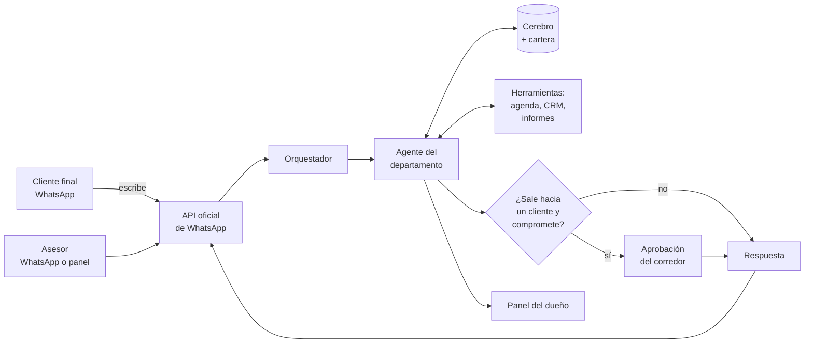
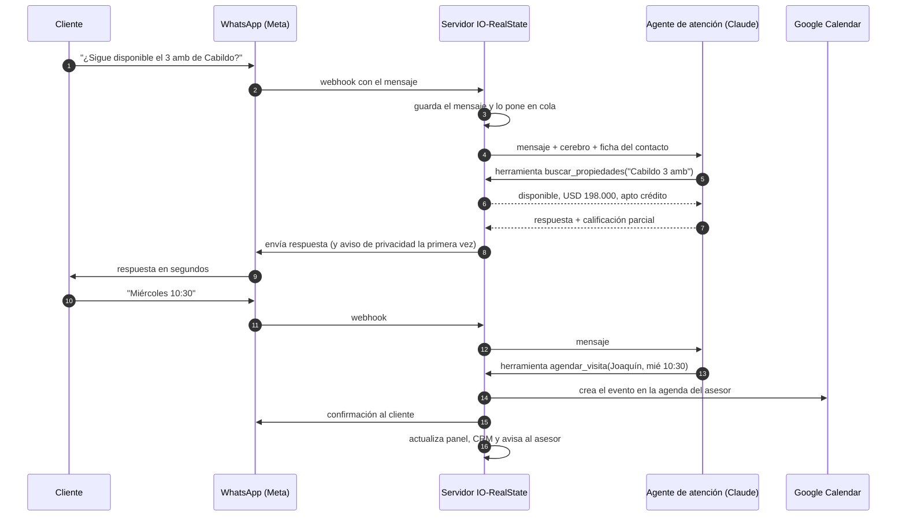

# 07 · Manual: cómo funciona IO-RealState

Para quien tiene que entender el producto sin ser técnico: el dueño de una inmobiliaria, un asesor,
o quien lo vende. Cada sección dice **qué ve la persona** y **qué pasa por detrás**. Al final hay una guía
para recorrer la demo y la lista de lo que la demo simula.

---

## 1. En una frase

IO-RealState le da a la inmobiliaria **un equipo de agentes de IA, uno por departamento**, que trabajan
con la información de esa inmobiliaria (su cartera, sus zonas, sus precios, su forma de hablar) y que se
usan por **WhatsApp** y por un **panel web**. Unos atienden a los clientes; otros le hacen trabajo al equipo.
Nada que comprometa a la inmobiliaria sale sin que lo apruebe el corredor matriculado.

---

## 2. Las piezas

| Pieza | Qué es | Dónde se ve |
|---|---|---|
| **Cerebro** | Todo lo que sabe la inmobiliaria, escrito en 10 temas (empresa, equipo, zonas, servicios y comisiones, cartera, propuesta de valor, marca y tono, objeciones, legales y plantillas, objetivos). Lo redacta un asistente entrevistando al dueño; el dueño lo aprueba. | Pantalla **Cerebro** |
| **Cartera** | Las propiedades con su estado (disponible, reservada, vendida). Se sincroniza todos los días. | Pantalla **Cerebro** |
| **Agentes** | Programas que usan Claude (el modelo de IA de Anthropic) con el cerebro y con herramientas concretas: buscar en la cartera, ver la agenda, agendar, armar un informe. Cada uno tiene su tarea y sus límites. | Pantalla **Agentes** |
| **Orquestador** | El que lee cada mensaje y decide qué agente lo atiende. | No se ve: trabaja por detrás |
| **Número de atención** | El WhatsApp de la inmobiliaria, conectado a la API oficial de WhatsApp. Ahí escriben compradores, propietarios e inquilinos. | El cliente usa su WhatsApp de siempre |
| **Chat del equipo** | Los asesores le escriben al asistente por WhatsApp (chat de uno a uno) o desde el panel. | Pantalla **Asistente** |
| **Panel** | Lo que ve el dueño: resultados, conversaciones, entregables, aprobaciones, configuración. | Pantallas **Hoy** y **Clientes** |
| **Aprobaciones** | La cola de lo que necesita la firma del corredor antes de salir (tasaciones, documentos). | Botón **Aprobar y firmar** |

---

## 3. Cómo arranca una inmobiliaria (onboarding)

Es lo único que pide horas del dueño. Se hace una vez.

| Paso | Qué hace la inmobiliaria | Qué hace el sistema | Tiempo |
|---|---|---|---|
| 1. Alta | Carga los datos del **corredor responsable** (nombre, matrícula, colegio) y acepta el contrato y el tratamiento de datos. | Verifica la matrícula en el padrón público y arma los pies legales. | 15 min |
| 2. WhatsApp | Elige el número de atención y verifica la empresa en Meta (Meta pide documentación del negocio). | Conecta el número a la API oficial y carga las plantillas de mensajes (recordatorios, avisos). | 1 a 10 días hábiles, según Meta |
| 3. Cerebro | Responde la entrevista del asistente (chat o voz) sobre los 10 temas. | Redacta cada documento; el dueño lo revisa y aprueba. | 2 a 3 horas |
| 4. Cartera | Sube un CSV/Excel o conecta su CRM. | Importa, detecta duplicados y propiedades sin estado. | 30 min |
| 5. Agendas | Cada asesor conecta su Google Calendar. | Lee la disponibilidad y escribe las visitas. | 5 min por asesor |
| 6. Agentes | Activa los que quiere. | Configura cada agente con el cerebro aprobado. | 10 min |
| 7. Prueba | El equipo le escribe al número como si fuera cliente durante 2 o 3 días. | Se corrigen respuestas antes de salir. | 2 a 3 días |
| 8. En vivo | Publica el número en portales, web y redes. | Empieza a atender. | — |

---

## 4. Flujo 1: un cliente escribe a las 23:14

**Qué ve el cliente:** escribe al WhatsApp de la inmobiliaria y recibe respuesta en segundos, con datos
reales de la propiedad, la ficha con fotos y una visita agendada. Al día anterior le llega un recordatorio.

**Qué ve el dueño a la mañana:** en **Hoy**, "Lo que hicieron anoche"; en **Clientes**, la conversación
completa y la ficha del cliente ya calificada (operación, zona, presupuesto, forma de pago, urgencia).

**Qué pasa por detrás:**

**Lo que el agente nunca hace** (reglas escritas en código, no solo en el texto del agente):

- No negocia precio ni acepta ofertas: las pasa al asesor con el resumen ("Hernán Sosa" en la demo).
- No ofrece propiedades reservadas o vendidas.
- No inventa datos: si algo no está en la cartera, dice que lo confirma un asesor.
- No da asesoramiento legal ni de financiación.
- No escribe primero a nadie que no haya aceptado recibir mensajes.

---

## 5. Flujo 2: un propietario quiere vender

1. Escribe al número: "¿Cuánto vale mi PH?".
2. El **agente de captación** explica que la tasación la hace la corredora en persona, toma los datos básicos
   (ambientes, metros, motivo, plazo) y agenda la visita en la agenda de la corredora.
3. Antes de la visita, el agente le arma al asesor un **brief del propietario**: qué busca, con quién más
   consultó y qué objeciones son probables.
4. Queda pedido el borrador de **ACM** (análisis comparativo de mercado) para esa propiedad (flujo 3).

---

## 6. Flujo 3: un asesor pide una tasación

**Qué hace el asesor:** escribe "#tasación Armame el ACM de Ugarte 1856, PH de 4 ambientes y 120 m² con
terraza" por WhatsApp o en **Asistente**.

**Qué pasa por detrás:**

1. El orquestador ve `#tasación` y lo manda al **agente de tasación**.
2. El agente busca **comparables**: propiedades parecidas vendidas o publicadas en la zona. Las fuentes son
   los cierres que cargó la inmobiliaria, su cartera y los comparables que agregue el asesor.
   No se toman datos de portales sin autorización (ver `08`).
3. Calcula el precio por m² (mediana de los comparables), aplica los ajustes declarados (por ejemplo, terraza
   propia) y arma un rango.
4. Genera el informe con la marca de la inmobiliaria, en página web o PDF.
5. El informe entra a la **cola de aprobación** como borrador. La corredora lo revisa, lo corrige si hace
   falta y lo **firma**. Recién ahí se puede mandar al propietario.

El informe dice siempre quién firma y que el borrador lo preparó un agente: una tasación es una opinión de
valor del corredor matriculado, no de un programa.

---

## 7. Flujo 4: análisis de competencia

El asesor pregunta "¿Cómo están captando propietarios mis competidores en Belgrano?". El **agente de
marketing** junta anuncios y publicaciones públicas de los competidores que la inmobiliaria definió en el
cerebro, los agrupa por ángulo ("tasación gratis", "vendé rápido"), marca lo que nadie está diciendo
(espacios libres) y propone piezas propias.

En la implementación real este flujo es **semiautomático**: la herramienta oficial de Meta no entrega por
API los anuncios comerciales en Argentina, así que el asesor comparte los enlaces o capturas de la
Biblioteca de anuncios y el agente hace el análisis (detalle en `08`).

---

## 8. Flujo 5: práctica de objeciones

El asesor escribe "Practiquemos la objeción 'la otra inmobiliaria me cobra menos comisión'". El **agente
de capacitación** hace de propietario, el asesor responde y al final recibe una **devolución** con los
criterios que definió la inmobiliaria (validó la objeción, mostró valor concreto, cerró con un paso
siguiente) y una sugerencia con datos propios. Sirve para asesores nuevos y para practicar antes de una
reunión difícil.

---

## 8 bis. Flujo 6: búsquedas que avisan (asesor individual)

Pensado para el asesor que tiene clientes compradores y hoy revisa portales a mano (plan completo en `09`).

**Qué hace el asesor:** le dice al asistente lo que busca cada cliente ("Familia Ocampo: 4 ambientes con patio o
terraza, Villa Urquiza o Coghlan, hasta USD 300 mil, cerca del colegio"). El agente separa lo **obligatorio** de lo
**deseable** y le arma los filtros para crear una alerta en cada portal. El asesor crea las alertas con su usuario.

**Qué pasa por detrás:** los portales mandan los avisos nuevos a la casilla de búsquedas. El agente los junta con lo
que llega de la red de colegas, **saca duplicados** (la misma propiedad en varios portales o con varias inmobiliarias)
y compara cada aviso con el cliente, incluido lo que los portales no filtran. A la mañana le avisa por WhatsApp
solo lo que coincide, ordenado por afinidad y con el porqué.

**Qué hace el asesor después:** marca **Me sirve** o **No**. Lo que descarta le enseña al agente ("no le muestres
PH con escalera"). Con lo elegido, el agente arma el **borrador del mensaje al cliente en la voz del asesor**:
aprendió cómo escribe de sus mensajes anteriores, sin emojis forzados, sin listas, sin frases de folleto. El asesor
lo revisa y lo manda desde su propio WhatsApp. Al ser un mensaje suyo, no hace falta avisar que intervino una IA.

**Lo que no hace:** no recorre portales con robots (va contra sus términos de uso); usa las alertas que los portales
ofrecen a cualquier usuario. Por eso los avisos llegan con la demora de cada alerta, no en tiempo real.

---

## 9. Quién hace qué

| Tarea | Agente | Persona |
|---|---|---|
| Responder consultas a cualquier hora | ✔ | Revisa conversaciones una vez por semana |
| Calificar y cargar el lead en el CRM | ✔ | — |
| Agendar visitas y tasaciones | ✔ | Mantiene su agenda al día |
| Negociar precio, aceptar ofertas, tomar reservas o señas | ✘ | ✔ Asesor / corredor |
| Borrador de tasación | ✔ | ✔ Revisa y **firma** el corredor |
| Fichas, textos para portales, guiones | ✔ | Aprueba antes de publicar |
| Rastrear avisos nuevos para cada cliente comprador | ✔ (con las alertas que crea el asesor) | Filtra con Me sirve / No |
| Mensaje al cliente con las opciones | Borrador en la voz del asesor | ✔ Lo revisa y lo manda el asesor |
| Recordatorios y tareas | ✔ (pedidos por WhatsApp) | — |
| Análisis de competencia | ✔ (con material que comparte el asesor) | Elige a quién mirar |
| Capacitación y práctica | ✔ | El asesor practica |
| Contratos | Borrador desde plantillas (fase 3) | ✔ Revisa y firma el corredor |
| Decidir qué agentes trabajan y con qué información | — | ✔ Dueño |

---

## 10. Cómo usar la demo

La demo está publicada en **https://ioconsultingarg.github.io/io-realstate/** y **funciona en el navegador**: lo que
cargues (búsquedas, avisos, tasaciones, cartera, recordatorios, respuestas) queda guardado en ese navegador y se puede
volver al ejemplo desde **Cuenta → Volver a los datos de ejemplo**. Los datos de ejemplo son ficticios.

| Pantalla | Qué probar |
|---|---|
| **Hoy** | El chat de las 23:14 se reproduce solo (botón **Pausar**). Pasar el mouse por los gráficos o tocar **Ver tabla** |
| **Clientes** | Filtrar por **Calientes**; abrir a Lucía, Tomás o Hernán; **Tomar la conversación** y escribirle al cliente |
| **Búsquedas** | **Nueva búsqueda** con lo que pide un cliente real; **Agregar aviso** → pegar el texto de un aviso o del mail de una alerta → **Leer aviso**: completa los datos y muestra la afinidad antes de guardar. Marcar **Me sirve** y ver el mensaje en tu voz; **No** para descartar. Escribir un recordatorio como por WhatsApp ("recordame llamar a Tomás el jueves 10") |
| **Asistente** | **#tasación** → **Editar inmueble y comparables**: cambiar la superficie, agregar ventas que conozcas o traer avisos de tus búsquedas; el valor se recalcula en vivo. **Ver informe** → **Aprobar y firmar** → **Imprimir o PDF**. Las otras dos tarjetas muestran competencia y práctica de objeciones |
| **Agentes** | Prender y apagar agentes: el contador de la barra superior cambia |
| **Cerebro** | **Importar CSV** de tu cartera (con **Plantilla** para ver el formato; acepta `;` como Excel en castellano) y cambiar el estado de cada propiedad |
| **Cuenta** | Tema claro u oscuro, manual en PDF y volver a los datos de ejemplo |

### Qué funciona de verdad y qué sigue simulado

| Funciona en la demo | Sigue simulado | En el producto real |
|---|---|---|
| Búsquedas, criterios, afinidad con el porqué, descartes, borrador del mensaje | La llegada automática de avisos (se pegan a mano) | Los avisos llegan solos desde las alertas de los portales; Claude lee el aviso completo |
| Lector de avisos pegados (dirección, barrio, ambientes, m², precio) | — | Claude lee el mail de la alerta entero, con fotos y descripción |
| Tasación: datos, comparables, cálculo, informe, firma e impresión | — | Comparables desde cierres propios, cartera y alertas; firma registrada con versión |
| Cartera por CSV con informe de lo que no se pudo leer | La sincronización diaria | Sincronización diaria con el CRM o el CSV |
| Recordatorios en lenguaje natural | El aviso a la hora indicada | Llega un WhatsApp a la hora del recordatorio |
| Responder a un cliente tomando la conversación | El envío real por WhatsApp | Sale por la API oficial de WhatsApp |
| — | Las conversaciones de los agentes y las respuestas del asistente a competencia y práctica | Las escribe Claude en el momento, con el cerebro de la inmobiliaria |
| — | Inicio de sesión y roles | Cada persona entra con su usuario |

## 11. Preguntas frecuentes

**¿El cliente sabe que le responde una IA?** Sí. El primer mensaje dice que es el asistente automatizado de
la inmobiliaria y enlaza la política de privacidad. Es una regla del producto (`03`).

**¿Puede equivocarse?** Sí. Por eso: trabaja solo con datos aprobados, dice "lo confirma un asesor" cuando
no sabe, no hace nada que comprometa a la inmobiliaria sin aprobación, y el dueño puede tomar cualquier
conversación desde el panel.

**¿Qué pasa si la cartera está desactualizada?** Responde mal. Es el riesgo número uno que mencionan todas
las fuentes (`02`). La cartera se sincroniza a diario y el panel muestra cuándo se actualizó cada propiedad.

**¿Reemplaza a los asesores?** No. Les saca lo repetitivo (responder, calificar, agendar, preparar) para que
hagan lo que solo hace una persona: visitar, negociar y cerrar.

**¿Por qué no grupos de WhatsApp por departamento, como la referencia?** Porque la API oficial de grupos
admite hasta 8 participantes y la reserva Meta para cuentas de gran volumen; la alternativa (programas que
imitan WhatsApp Web) viola los términos de Meta y puede hacer que bloqueen el número de la inmobiliaria.
El asesor le escribe al asistente en un chat de uno a uno y el panel ordena todo por departamento.
