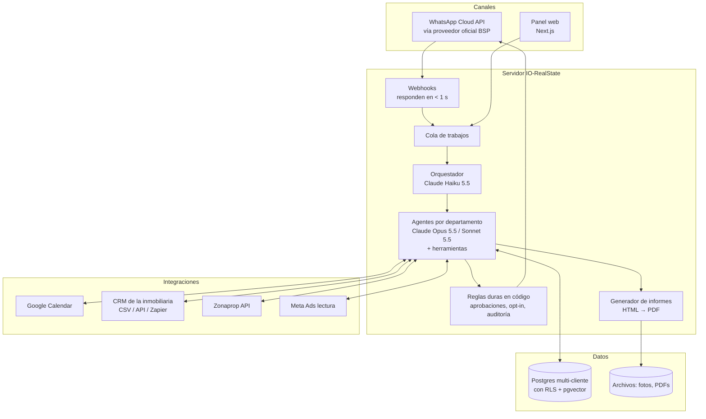

# 08 · Factibilidad de la implementación real, de punta a punta

Relevado el 14/11/2026. Responde una pregunta: **¿se puede construir y operar IO-RealState de verdad, con
qué, en cuánto tiempo, a qué costo y con qué riesgos?** Las fuentes están al final. Lo que no se pudo
confirmar en fuente oficial está marcado **[a confirmar]**.

---

## 1. Veredicto

**Es factible hoy, con tres ajustes al diseño original.** La IA no es el cuello de botella: Claude ya
resuelve atender, calificar, redactar, calcular y explicar. Lo difícil está en tres lugares:

1. **El alta de WhatsApp de cada cliente** (verificación en Meta, número, plantillas).
2. **Los datos de la inmobiliaria**: una cartera al día y comparables confiables para tasar.
3. **El marco legal**: datos personales, Registro No Llame, UIF y el rol del corredor matriculado.

| | Componente | Factible | Comentario |
|---|---|---|---|
| ✅ | Atención 24/7 por WhatsApp con la API oficial | Sí | Meta permite asistentes de IA **específicos del negocio**. Desde el 15/01/2026 prohíbe solo los asistentes de propósito general |
| ✅ | Calificación, ficha del cliente, derivación al asesor | Sí | Salidas estructuradas de Claude + reglas en código |
| ✅ | Agenda de visitas en Google Calendar | Sí | Requiere la verificación de la app en Google (permiso "sensible"); mientras tanto alcanza para 100 usuarios de prueba **[a confirmar el plazo]** |
| ✅ | Cerebro con entrevista guiada | Sí | Es redacción asistida + aprobación |
| ✅ | Borrador de tasación (ACM) con firma del corredor | Sí, **si hay comparables** | La calidad depende de los datos (ver §4) |
| ✅ | Fichas, textos, guiones, plan de contenido | Sí | — |
| ✅ | Práctica de objeciones con devolución | Sí | — |
| ✅ | Panel del dueño, aprobaciones, auditoría | Sí | Desarrollo propio |
| 🟡 | Cartera desde el CRM de la inmobiliaria | Depende del CRM | No se encontró API pública documentada de Tokko Broker (sí integración vía Zapier). Zonaprop tiene API (Navent) para publicar y leer mensajes. Arranque con CSV |
| 🟡 | Análisis de competencia | Semiautomático | La API de la Biblioteca de anuncios de Meta **no devuelve anuncios comerciales fuera de la UE**. El asesor comparte enlaces o capturas; Claude analiza |
| 🟡 | Leer métricas de Meta Ads de la propia inmobiliaria | Sí, con revisión de la app en Meta | Escribir (prender/apagar) queda para después |
| 🔴 | **Bots dentro de grupos de WhatsApp** (como la referencia) | **No, para este segmento** | La API oficial de grupos admite **8 participantes** y la reserva a cuentas oficiales de gran volumen. Lo no oficial arriesga el bloqueo del número |
| 🔴 | Leer avisos de portales para tasar o espiar competencia | **No** sin acuerdo | Scrapear va contra los términos de uso de los portales |

---

## 2. Arquitectura real

Decisiones que cambian respecto de `05`:

- **Canal del equipo:** chat de uno a uno con el asistente + panel (confirmado: los grupos no son viables).
- **WhatsApp por proveedor (BSP) al principio**, no directo con Meta: el BSP resuelve el alta del número de
  cada cliente (registro embebido) mientras IO Consulting no sea *Tech Provider* de Meta.
- **Competencia semiautomática**, sin depender de la API de anuncios.

---

## 3. Qué hace falta, cuenta por cuenta

| Cuenta / trámite | Quién | Para qué | Plazo estimado |
|---|---|---|---|
| Meta Business verificado (de cada inmobiliaria) | Cliente, guiado por nosotros | Habilitar su número en la API | 1 a 10 días hábiles **[a confirmar]** |
| Proveedor de WhatsApp (BSP: 360dialog, Twilio, Gupshup u otro) | IO Consulting | Alta de números y envío de mensajes | 1 semana |
| Plantillas de mensajes aprobadas (confirmación, recordatorio, aviso) | IO Consulting | Escribir primero, fuera de las 24 h | 1 a 2 días por plantilla |
| Organización en la API de Anthropic | IO Consulting | Usar Claude | Inmediato |
| Proyecto en Google Cloud + verificación de la pantalla de consentimiento | IO Consulting | Leer y escribir agendas | 2 a 6 semanas **[a confirmar]**; el piloto funciona antes |
| Revisión de app en Meta (Marketing API, solo lectura) | IO Consulting | Métricas de anuncios del cliente | 2 a 4 semanas, fase 2 |
| Acceso a API de Zonaprop / pedido de API a Tokko y Argenprop | IO Consulting | Cartera y consultas de portales | Variable, gestión comercial |
| Hosting (base de datos, web, trabajos en segundo plano) | IO Consulting | Operar | 1 día |
| Inscripción de bases en la AAIP, contrato + DPA, política de privacidad | IO Consulting + abogado | Ley 25.326 | 2 a 4 semanas |
| Procedimiento de consulta al Registro No Llame | IO Consulting | Campañas salientes (fase 2) | 1 semana |

---

## 4. El problema de los datos (lo que más decide el éxito)

**Cartera.** Si el agente ofrece una propiedad vendida, la inmobiliaria queda mal. Requisitos:
sincronización diaria, estado obligatorio y fecha de actualización visible. Camino realista:

1. Piloto: CSV/Excel exportado del CRM, subido a diario (o automático vía Zapier, que sí tiene integración con Tokko).
2. Después: API del CRM donde exista; si no, pedir acceso al proveedor.

**Comparables para tasar.** Es el punto débil. Fuentes legítimas, en orden:

1. **Cierres propios** que la inmobiliaria carga (precio real de venta, m², fecha, días en el mercado).
2. **Su propia cartera** publicada.
3. **Comparables que agrega el asesor** (dirección, m², precio) desde lo que ve en portales.
4. Informes de mercado pagos o públicos que la inmobiliaria ya use.

Con 1 a 3, el ACM es tan bueno como la tasación que hoy hace el asesor, pero en minutos y con formato
profesional. Sin datos propios, el agente debe decirlo y no inventar un rango.

---

## 5. Costos

### 5.1 Costo variable por inmobiliaria de 10 asesores (USD/mes)

Supuestos: 600 consultas de clientes por mes (unas 5 respuestas cada una), 300 pedidos internos, 30 informes
pesados, 19 visitas con confirmación y recordatorio.

| Concepto | Cálculo | Bajo | Alto |
|---|---|---|---|
| Claude: atención | 4.800 turnos; Sonnet 5.5 ≈ 0,014 / Opus 5.5 ≈ 0,027 | 67 | 130 |
| Claude: orquestador (Haiku 5.5) | 5.100 × ≈ 0,001 | 5 | 5 |
| Claude: pedidos internos (Opus 5.5) | 300 × ≈ 0,18 | 54 | 54 |
| Claude: informes con búsqueda | 30 × ≈ 0,60 | 18 | 18 |
| WhatsApp: mensajes de servicio | ≈ 3.600 respuestas − 1.000 gratis × ≈ 0,026 **[a confirmar]** | 68 | 68 |
| WhatsApp: plantillas de utilidad | 38 × ≈ 0,030 | 1 | 1 |
| Proveedor de WhatsApp (BSP) | cuota por número **[a cotizar]** | 0 | 50 |
| Infraestructura (parte proporcional) | base de datos, web, trabajos, PDFs | 10 | 20 |
| **Total** | | **≈ 223** | **≈ 346** |

**Corrección importante a `04` y `05`:** según los tarifarios publicados por los proveedores, desde el
**1/10/2026 Meta cobra también los mensajes de servicio** (las respuestas a quien escribió primero), después
de 1.000 gratis por mes y por número. Antes eran gratis. Con eso, **el plan "Inmobiliaria" a USD 249 no
cubre el costo** de un cliente con este volumen.

### 5.2 Precios recomendados (hipótesis a validar)

| Plan | Antes (`04`) | Ahora | Razón |
|---|---|---|---|
| Independiente | USD 49 | **USD 69** | Sin número de atención; ≈ USD 20 a 25 de costo |
| Inmobiliaria (hasta 10 asesores, hasta 600 consultas) | USD 249 | **USD 449** | Margen ≈ 25 a 50 % según el modelo usado en atención |
| Consultas extra | — | **USD 0,40 por consulta** sobre el tope | Traslada el costo de WhatsApp + IA al volumen real |
| Implementación asistida | Según diagnóstico | Pago único | Onboarding, cerebro y capacitación |

Para bajar costo sin perder calidad: probar **Sonnet 5.5 en atención** con una evaluación de conversaciones
reales (la diferencia es ≈ USD 60/mes por cliente), aprovechar la **caché del cerebro** y el **procesamiento
por lotes** (50 % menos) para reportes no urgentes.

### 5.3 Costo de construirlo

| Fase | Contenido | Semanas | Horas aprox. |
|---|---|---|---|
| 0. Preparación | Cuentas (Meta, BSP, Anthropic, Google), abogado, plantillas | 1–2 | 30 |
| 1. Núcleo | Multi-cliente, webhooks, cola, orquestador, agente de atención con 4 herramientas, panel de conversaciones, cartera CSV, Google Calendar | 3–6 | 180 |
| 2. Equipo interno | Cerebro con entrevista, tasación + PDF + aprobaciones, fichas, práctica de objeciones, competencia semiautomática | 7–9 | 140 |
| 3. Piloto | 1 o 2 inmobiliarias, evaluación con conversaciones reales, ajustes | 10–13 | 80 |
| **Total** | | **≈ 13 semanas** | **≈ 430 h** |

Estimado para un desarrollador full-stack con experiencia en TypeScript, con Gonzalo en producto y
relación con el cliente. Costos fijos de operación antes del primer cliente: ≈ USD 60–100/mes (hosting y
herramientas), más honorarios del abogado.

---

## 6. Legal: estado verificado

| Tema | Estado | Qué implica |
|---|---|---|
| Corretaje (Ley 2340 CABA; colegios provinciales) | Vigente | Solo un corredor matriculado intermedia. El producto asiste, no intermedia; se vende a quien tenga corredor responsable |
| Datos personales (Ley 25.326) | **Vigente**; hay proyectos de reemplazo en el Congreso (por ejemplo, expediente 3397-D-2026) sin sanción | Inscripción en la AAIP, consentimiento, DPA, transferencia internacional declarada. Seguir el proyecto: puede endurecer reglas sobre IA y decisiones automatizadas |
| UIF (Ley 25.246; **Resolución UIF 43/2024**, modificada por la 56/2024) | Vigente | Los corredores son sujetos obligados con reportes mensuales y anuales. Oportunidad: checklist de debida diligencia (fase 3). El agente no debe tomar datos de operaciones fuera de ese circuito |
| Registro No Llame (Ley 26.951) | Vigente | Salientes solo con opt-in y consulta al registro |
| Política de WhatsApp sobre IA | Vigente desde 15/01/2026 | Agente acotado al negocio inmobiliario del cliente: permitido |
| Alquileres (DNU 70/2023) | Vigente según el Colegio | Ajustes según lo que dice cada contrato |

---

## 7. Riesgos y cómo se mitigan

| Riesgo | Probabilidad | Impacto | Mitigación |
|---|---|---|---|
| El agente responde con datos viejos de la cartera | Alta | Alto | Sincronización diaria, estado obligatorio, "lo confirma un asesor" cuando falta el dato |
| Meta demora o rechaza la verificación de un cliente | Media | Alto | Arrancar el trámite en la semana 1 del onboarding; BSP con experiencia |
| El costo de WhatsApp crece con el volumen | Alta | Medio | Precio con tope de consultas y excedente por consulta |
| Tasaciones con pocos comparables | Alta | Medio | Pedir cierres propios en el onboarding; mostrar la cantidad y calidad de comparables en el informe |
| Cambios de política de Meta | Media | Alto | Agente estrictamente del negocio; no depender de grupos ni de APIs no oficiales |
| El equipo no adopta el panel | Media | Medio | Todo lo diario funciona por WhatsApp; el panel es para el dueño |
| Reclamo por datos personales | Baja | Alto | DPA, aviso en el primer mensaje, minimización, borrado a pedido, auditoría |
| Error del agente que compromete a la inmobiliaria | Baja | Alto | Reglas en código: sin precios, sin ofertas, aprobación del corredor para todo lo que compromete |

---

## 8. Cómo seguir: decisión en tres pasos

1. **Validar antes de construir (2 semanas).** Mostrar la demo a 5 inmobiliarias con 3 a 20 asesores.
   Seguir solo si al menos 2 aceptan ser piloto con el precio de §5.2 y tienen una cartera exportable.
2. **Piloto pago reducido (13 semanas).** Fases 0 a 3 con 1 o 2 inmobiliarias. Criterios de éxito: primera
   respuesta en menos de 1 minuto en el 95 % de las consultas, al menos 30 % atendidas fuera de horario,
   visitas agendadas por el agente, y que el dueño use 3 entregables internos por semana.
3. **Escalar.** Solo si el piloto cumple: pasar a *Tech Provider* de Meta, conectores con CRM y portales,
   y los agentes de fase 2 (alquileres, ventas, publicidad).

---

## Fuentes

- Política de WhatsApp Business sobre chatbots de propósito general: [TechCrunch](https://techcrunch.com/2025/10/18/whatssapp-changes-its-terms-to-bar-general-purpose-chatbots-from-its-platform/), [respond.io](https://respond.io/blog/whatsapp-chatbot-policy-2026)
- API de grupos de WhatsApp: [Meta for Developers](https://developers.facebook.com/documentation/business-messaging/whatsapp/groups/), [hilo sobre el límite de 8 participantes](https://developers.facebook.com/community/threads/1084199161066371/), [Kapso](https://kapso.ai/blog/whatsapp-groups-api-state-2026)
- Precios de WhatsApp para Argentina (vigencia 1/10/2026): [ManyChat](https://help.manychat.com/hc/en-us/articles/14281380243740-WhatsApp-pricing-guide), [SleekFlow](https://help.sleekflow.io/en_US/whatsapp/pricing), [Infobip](https://www.infobip.com/whatsapp-business/pricing)
- API de la Biblioteca de anuncios de Meta: [referencia ads_archive](https://developers.facebook.com/docs/graph-api/reference/ads_archive/), [adlibrary.com](https://adlibrary.com/posts/eu-dsa-ad-repositories-developers)
- Tokko Broker: [integraciones en Zapier](https://zapier.com/apps/tokko-broker), [centro de ayuda](https://intercom.help/tokko-broker/es/)
- Zonaprop: [API (documentación de Mapaprop sobre Navent)](https://help.mapaprop.com/en/api/property-api/zonaprop-api)
- UIF: [Resolución 43/2024](https://www.argentina.gob.ar/normativa/nacional/397424/texto), [Marval O'Farrell Mairal](https://www.marval.com/publicacion/la-uif-actualiza-la-normativa-aplicable-a-los-agentes-o-corredores-inmobiliarios-15804)
- Datos personales: [AAIP, proyecto de ley](https://www.argentina.gob.ar/aaip/datospersonales/proyecto-ley-datos-personales), [Marval sobre los proyectos](https://www.marval.com/Publicacion/nuevos-proyectos-de-ley-de-datos-personales-en-argentina-17289?lang=en)
- Colegio Inmobiliario (CUCICBA): ver `03-MARCO-LEGAL-AR.md`
- Precios de la API de Claude: documentación de Anthropic al 03/11/2026 (ver `05`)
