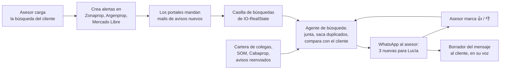

# 09 · Plan para el asesor individual

Agregado el 15/11/2026 a partir del pedido de un agente inmobiliario en actividad, colega de Gonzalo.
Resumen de lo que pidió, en sus términos:

- Tiene **3 búsquedas activas**: clientes compradores con el dinero disponible.
- Hoy revisa portales, busca opciones y filtra a mano. Quiere que **un agente busque por él** con los criterios
  de cada cliente y que **le avise cuando aparece algo nuevo** que coincide. Él solo filtra.
- Lo que más tiempo le ahorra a un asesor: **ACM, búsqueda, agenda, citas y tareas**.
- **Los mensajes que salen no pueden parecer escritos por una IA.**

Este documento ajusta el producto a ese pedido. No reemplaza el modelo para inmobiliarias (`04`): cambia el
orden en que se construye.

---

## 1. Por qué empezar por el asesor individual

| | Inmobiliaria (plan original) | Asesor individual (este plan) |
|---|---|---|
| Canal | Número propio en la API de WhatsApp, trámite en Meta por cliente | El asesor le escribe al **número de IO-RealState**; sus clientes le siguen escribiendo a su WhatsApp personal |
| Quién manda los mensajes al cliente final | El agente (modo automático) | **El asesor**, con un borrador del agente (modo borrador) |
| Costo de WhatsApp | Alto (mensajes de servicio cobrados desde 10/2026) | Bajo: solo la conversación asesor ↔ asistente |
| Onboarding | 1 a 10 días (verificación de Meta) | **El mismo día** |
| MVP | ≈ 13 semanas | **≈ 5 a 7 semanas** |
| Venta | Diagnóstico + implementación | Prueba directa con 3 búsquedas reales |

---

## 2. Búsquedas que avisan (el pedido principal)

### Cómo funciona

1. **Carga de la búsqueda.** El asesor le dice al asistente, por WhatsApp o en el panel: "Familia Ocampo: 4 ambientes con
   patio o terraza, Villa Urquiza o Coghlan, hasta USD 300 mil, cerca del colegio, si tiene cochera mejor". El agente
   separa lo **obligatorio** de lo **deseable** y le confirma.
2. **Alertas de los portales.** El agente le arma los filtros que tiene que cargar en cada portal (zona, ambientes,
   precio) y la dirección de reenvío. El asesor crea las alertas con su usuario; los portales las mandan por mail.
   **No se recorren portales con robots**: se usan las alertas que los portales ofrecen a cualquier usuario.
3. **Procesamiento.** Cada mail de alerta se lee, se extraen los avisos, se **sacan duplicados** (la misma propiedad
   publicada por varias inmobiliarias o en varios portales: misma dirección, m² y precio parecido) y se compara cada
   aviso con la búsqueda, incluido lo que los portales no filtran ("luminoso", "sin escaleras", "cerca del colegio").
4. **Aviso.** Una vez por la mañana (o al momento, si algo coincide muy bien) llega un WhatsApp: "Entraron 3 para la
   familia Ocampo: 2 muy buenas y 1 posible", con el porqué de cada una.
5. **Filtro del asesor.** 👍 la guarda para mandar; 👎 la descarta y el agente aprende (por ejemplo, "no le muestres PH
   con escalera").
6. **Envío al cliente.** El agente arma el **borrador** del mensaje con las elegidas, en la voz del asesor.

### Límites honestos

- Llega a lo nuevo **con la demora de la alerta de cada portal** (minutos u horas), no en tiempo real.
- Ve solo lo que el portal manda en la alerta; para el detalle, abre el aviso.
- Depende de que el asesor cree las alertas (5 minutos por cliente y portal). El agente le dice exactamente qué cargar.
- Si un portal cambia el formato de sus mails, hay que ajustar el lector.

---

## 3. "Que no parezca IA": modo borrador en la voz del asesor

- **El agente escribe, el asesor manda.** El borrador llega listo; el asesor lo revisa y lo envía con un toque desde su
  WhatsApp (o lo copia). Es un mensaje suyo, así que no hace falta el aviso de "asistente automatizado" de `03`, que
  sigue valiendo para el modo automático de las inmobiliarias.
- **Aprende su forma de escribir.** En el onboarding el asesor pega 20 o 30 mensajes que mandó a clientes. El agente
  extrae su estilo: cómo saluda, si tutea, largo de las frases, si usa emojis, cómo firma. Las reglas quedan visibles y
  editables ("Saluda con 'Hola' y el nombre", "Sin emojis", "Frases cortas").
- **Reglas anti-IA fijas:** nada de "¡Hola! 😊", "Espero que estés muy bien", listas con viñetas, negritas, párrafos
  perfectos ni "No dudes en consultarme". Mensajes cortos, como se escribe por WhatsApp.
- **Variación:** dos clientes nunca reciben el mismo texto.

---

## 4. ACM, agenda y tareas

- **ACM:** igual que en `07` §6. Mejora con este plan: los avisos que llegan por las alertas quedan como **comparables
  publicados** de la zona, sin scrapear, y cubren parte del problema de datos de `08` §4.
- **Agenda:** Google Calendar del asesor. "Agendame la visita con los Ocampo el sábado a las 11 en Pedraza 2450" crea
  el evento con la dirección.
- **Tareas por WhatsApp:** "Recordame llamar a Tomás el jueves" o "mañana mandarle a Lucía las opciones" se convierten en
  recordatorios que llegan a la hora indicada. Lista de pendientes en el panel.

---

## 5. MVP del asesor individual

| Semana | Entrega |
|---|---|
| 1 | Usuarios, número de IO-RealState en la API de WhatsApp (uno solo, propio), chat asesor ↔ asistente |
| 2–3 | Búsquedas: carga conversada, casilla de alertas, lector de mails de Zonaprop, Argenprop y Mercado Libre, duplicados, afinidad, aviso diario, 👍/👎 |
| 4 | Borradores en la voz del asesor (estilo aprendido + reglas anti-IA) |
| 5 | Tareas y recordatorios; agenda en Google Calendar |
| 6 | ACM con comparables de las alertas y los que cargue el asesor |
| 7 | Piloto con el colega (sus 3 búsquedas reales) y ajustes |

Fuera del MVP: atención automática a clientes, agentes de marketing y capacitación, multi-usuario.

### Costos y precio (hipótesis)

| Concepto | USD/mes por asesor |
|---|---|
| Claude (búsquedas diarias, borradores, ACM, tareas) | ≈ 8 a 15 |
| WhatsApp (asesor ↔ asistente; bajo el umbral de 1.000 gratis por número se reparte entre todos) | ≈ 1 a 3 |
| Infraestructura (parte proporcional) | ≈ 2 a 4 |
| **Total** | **≈ 11 a 22** |

Precio sugerido: **USD 49 por mes** (el plan "Independiente" de `08` §5.2 puede bajar a este valor sin el número de
atención). Primeros pilotos gratis a cambio de feedback semanal.

### Criterios para el piloto con el colega

- En dos semanas, el agente le encuentra **todas** las propiedades nuevas que él habría encontrado a mano, y al menos
  una que no vio.
- Menos del 30 % de lo que le avisa termina en 👎.
- Manda los borradores sin reescribirlos en al menos la mitad de los casos.
- Dice que le ahorra tiempo real (medir: horas por semana buscando, antes y después).

---

## 6. Riesgos propios de este plan

| Riesgo | Mitigación |
|---|---|
| Un portal deja de mandar alertas por mail o cambia el formato | Varios portales en paralelo; lector por portal fácil de ajustar; reenvío manual siempre disponible |
| Términos de uso de los portales sobre el reenvío automático de sus alertas **[a confirmar]** | Revisarlos antes del piloto; el asesor usa su propia cuenta y sus propias alertas |
| Los borradores igual "suenan a IA" | Estilo aprendido de mensajes reales, reglas fijas y prueba ciega con el colega |
| El asesor no carga las alertas | Instrucción paso a paso por portal, con los filtros ya armados |
